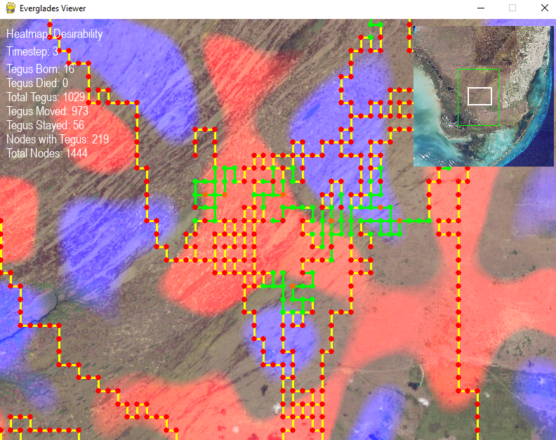

# Modeling Invasive Tegu Populations

**[Run it in your browser](https://boaxes.github.io/Modeling-Invasive-Tegu-Populations/)** (no install needed)

A TypeScript rewrite of the simulation software for the agent-based model of invasive Argentine black and white tegus (*Salvator merianae*) spreading across the Florida Everglades, presented in [this paper](https://drive.google.com/file/d/1JGha21ooZma4E8qc3kM4hL-1Og2eA54A/view?usp=sharing) (model discussion starts on page 8). The viewer is new TypeScript; the model itself is the original Python, running in your browser via [Pyodide](https://pyodide.org).



## Controls

- `W`, `A`, `S`, `D`: pan around the map
- Mouse wheel: zoom in and out
- Click a node: show its details
- `Space` or **Step**: advance the simulation by one timestep
- `H` or **Heatmap**: cycle between no heatmap, habitat desirability, and tegu count
- **Seed** + **Restart**: start a reproducible run (leave the seed blank for a random one)
- **Save frame**: download the heatmap image for the current timestep

Statistics, the selected node, an overview map, and population graphs are shown beside the map.

## Example runs

| Seed 1 | Seed 2 |
|:---:|:---:|
|  |  |

*Two random initial seeds, each simulated over 100 timesteps. Red is high habitat desirability, blue is low habitat desirability, and green is tegu population density. GIFs like these can be made from saved frames.*

## Motivation

Argentine black and white tegus are one of Florida's most damaging invasive species, threatening native wildlife including American alligators, gopher tortoises, and ground-nesting birds. Traditional population models treat spread as a continuous diffusion process, losing the individual-level behavior that drives real invasion dynamics. This project explores whether an agent-based approach, where each tegu makes its own movement and reproduction decisions based on local habitat, better captures the spatial patterns of an active invasion.

## How it works

- `tegu_sim/`: the model, in Python (`numpy`, `scipy`). It builds the habitat field and the graph of nodes, then moves, ages, and breeds the tegus each timestep.
- `web/`: the TypeScript viewer. It runs the Python model in a Web Worker through Pyodide and draws it on a canvas over satellite imagery.

## Running locally

```bash
cd web
npm install
npm run build
cd ..
py -3 -m http.server 8000   # then open http://localhost:8000/web/
```

The site is deployed to GitHub Pages by `.github/workflows/pages.yml` on every push to `main`.

## Versions

- **V2** (current): Rewrote frontend in TypeScript. The Python model runs in the browser.
- **V1**: The original `pygame` desktop viewer, kept in [`Archive/`](Archive/) and the [`V1`](https://github.com/Boaxes/Modeling-Invasive-Tegu-Populations/tree/V1) tag.
